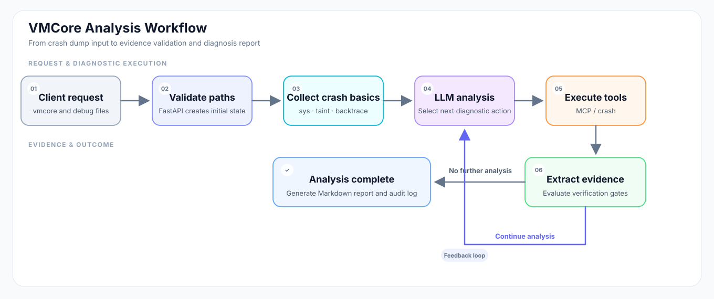

# VMCore Analysis Agent

[简体中文](./README.zh-CN.md) | English


A vmcore analysis service built with LangGraph, MCP, and the Linux `crash` utility. The application lives in [`vmcore-analysis-agent/`](./vmcore-analysis-agent/); this README explains its workflow, deployment, and outputs.

## What it does

The service accepts a vmcore, its matching `vmlinux`, `vmcore-dmesg.txt`, and optional module debug symbols. It runs an agent loop that invokes `crash` commands and produces a Markdown analysis report. Treat the result as diagnostic assistance: verify it against the kernel version, debug symbols, and incident context.

Key capabilities:

- Collects crash basics first, then selects diagnostic actions from the current analysis state.
- Calls `crash` and related tools through MCP, with action guards and command deduplication.
- Tracks hypotheses and verification gates. Gate closure is evaluated by the executor against tool evidence rather than accepted from the model directly.
- Provides synchronous and SSE streaming APIs; a separate Gate audit file can accompany the report.

## How it works



An analysis follows these steps:

1. FastAPI validates the supplied paths and creates the initial agent state.
2. LangGraph runs initial `crash` commands to collect system, taint, and backtrace information.
3. The LLM selects the next diagnostic step or tool call; `action_guard` and the executor constrain and run tool actions.
4. The evidence evaluator extracts facts from tool output and updates gates. The analysis cannot be marked conclusive while required gates have not reached `closed` or `n/a`.
5. The service returns the analysis. The client saves a Markdown report by default and, when Gate data is present, a companion `.audit.md` file.

### Core directories

| Path | Responsibility |
|---|---|
| [`main.py`](./vmcore-analysis-agent/main.py) | FastAPI service, analysis APIs, and lifecycle initialization |
| [`client/`](./vmcore-analysis-agent/client/) | HTTP/SSE client and CLI entry point |
| [`src/react/`](./vmcore-analysis-agent/src/react/) | LangGraph nodes, routing, state, prompts, evidence evaluation, and report generation |
| [`src/llm/`](./vmcore-analysis-agent/src/llm/) | LLM client creation |
| [`src/mcp_tools/`](./vmcore-analysis-agent/src/mcp_tools/) | MCP tool registration and crash, source-patch, and related tools |
| [`tests/`](./vmcore-analysis-agent/tests/) | Unit and integration tests |
| [`doc/`](./vmcore-analysis-agent/doc/) | Architecture flow diagrams and project documentation |
| [`reports/`](./vmcore-analysis-agent/reports/) | Local report output directory |

## Prerequisites

Run the service on a Linux host that can access the vmcore files. Prepare:

- Python 3.11 or later and [`uv`](https://docs.astral.sh/uv/).
- The Linux `crash` utility and the `vmlinux` debug symbols matching the vmcore's kernel.
- The corresponding `vmcore-dmesg.txt`.
- Optional debug symbols (`.ko`) for third-party kernel modules under investigation.
- An accessible OpenAI-compatible model service and API key.

The repository's mpykdump installer targets x86_64 and includes extensions for crash 8.0 and 9.0. For other crash versions, provide a compatible extension yourself.

## Quick start

Commands below use a Linux shell.

### 1. Install dependencies

From the repository root:

```bash
cd vmcore-analysis-agent
uv sync
```

To install the bundled mpykdump extension, run this from the `vmcore-analysis-agent` directory. The script writes to the system crash extension directory and may require `sudo`:

```bash
bash tools/install_mpykdump.sh
```

### 2. Configure the model

Copy the template:

```bash
cp .env.example .env
```

Edit `vmcore-analysis-agent/.env` with valid model credentials and endpoint details:

```dotenv
REASONING_API_KEY=replace-with-your-api-key
REASONING_BASE_URL=https://token-plan.cn-beijing.maas.aliyuncs.com/compatible-mode/v1
REASONING_MODEL=deepseek-v4.1-flash-1017

REASONING_THINKING=enabled
REASONING_EFFORT=max
REASONING_TEMPERATURE=0.1
REASONING_CONTEXT_WINDOW=524288
REASONING_MAX_OUTPUT_TOKENS=48000
REASONING_MIN_THINKING_OUTPUT_TOKENS=40960
REASONING_HISTORY_KEEP=2
LANGSMITH_TRACING=false

# Optional: kernel source tree used for source-level verification.
# KERNEL_SOURCE_ROOT=/data/kernel-src/4.18.0-305.130.1.el8_4.x86_64
KERNEL_SOURCE_ROOT=
```

| Variable | Required | Description |
|---|---:|---|
| `REASONING_API_KEY` | Yes | API key for the model service |
| `REASONING_BASE_URL` | Yes | OpenAI-compatible model API endpoint |
| `REASONING_MODEL` | Yes | Model name used by the service |
| `REASONING_THINKING` | No | `enabled` or `disabled`; defaults to `disabled` |
| `REASONING_EFFORT` | No | Reasoning effort; defaults to `max` |
| `REASONING_TEMPERATURE` | No | Sampling temperature; defaults to `0.1` |
| `REASONING_CONTEXT_WINDOW` | No | Context budget; defaults to `524288`. Set it according to the provider's actual limits. |
| `REASONING_MAX_OUTPUT_TOKENS` | No | Maximum completion budget; defaults to `48000` |
| `REASONING_MIN_THINKING_OUTPUT_TOKENS` | No | Minimum remaining output budget for thinking mode; defaults to `40960` |
| `REASONING_HISTORY_KEEP` | No | Number of reasoning history items to keep during compression; defaults to `2` |
| `KERNEL_SOURCE_ROOT` | No | Kernel source tree matching the analysed dump (or a directory of per-version trees). Used only when a request does not carry `kernel_source_root`. Enables `read_source` / `list_writers` / `git_history`; when empty, the agent reports that source could not be verified instead of quoting kernel code from memory |
| `LANGSMITH_TRACING` | No | Enable LangSmith tracing; defaults to `false` |

Process environment variables take precedence over `.env`. The service fails during startup if a required model variable is missing or a setting is invalid. Do not commit `.env` files containing real credentials. MCP tools are discovered by the code; MCP server paths do not need to be added to `.env`.

### 3. Start the service

From the `vmcore-analysis-agent` directory:

```bash
uv run uvicorn main:app --host 0.0.0.0 --port 8000
```

- Health check: <http://localhost:8000/health>
- API documentation: <http://localhost:8000/docs>
- Metrics: <http://localhost:8000/metrics>

The API currently has no built-in authentication. Restrict network access in production or put it behind a protected reverse proxy/API gateway.

### 4. Run an analysis

The client must be able to reach the service, and paths in the request must be **accessible on the server host** (the client does not upload vmcore files).

```bash
cd client
uv run main.py --health --url http://localhost:8000

uv run main.py --url http://localhost:8000 --stream \
  --vmcore-path /data/case/vmcore \
  --vmlinux-path /usr/lib/debug/lib/modules/<kernel-version>/vmlinux \
  --vmcore-dmesg-path /data/case/vmcore-dmesg.txt \
  --debug-symbols /data/case/driver.ko \
  --kernel-source-root /root/kernel-sources/8/4.18.0-553.22.1.el8_10/BUILD/kernel-4.18.0-553.22.1.el8_10/linux-4.18.0-553.22.1.el8_10.x86_64 \
  --output-dir ../reports
```

`--kernel-source-root` is optional; step 5 shows how to prepare the source directory it points at.

Common CLI options:

| Option | Description |
|---|---|
| `--url` | API service URL; defaults to `http://localhost:8000` |
| `--health` | Only check service health |
| `--stream` | Use the SSE endpoint; without it, use the synchronous endpoint |
| `--vmcore-path` | Path to the vmcore |
| `--vmlinux-path` | Path to the matching `vmlinux` |
| `--vmcore-dmesg-path` | Path to `vmcore-dmesg.txt` |
| `--debug-symbols` | Optional module debug-symbol paths; accepts multiple paths |
| `--kernel-source-root` | Kernel source tree visible on the server, normally the directory produced by `rpmbuild -bp kernel.spec` (containing `Makefile` plus `kernel/` or `include/linux/`). Overrides `KERNEL_SOURCE_ROOT`; when empty, the deployment default is used |
| `--timeout` | Request timeout in seconds; defaults to `600` |
| `--output-dir` | Report directory; defaults to `../reports` relative to the current `client` directory |
| `--no-save` | Do not save report files |

### 5. Prepare the kernel source (optional, enables source-level verification)

With a matching source tree, the agent can read the exact code behind a `file:line` returned by `dis -s`, enumerate the code paths that can write a field, and check whether this tree already carries a fix. Without it, the agent states that the source could not be verified instead of quoting kernel code from memory.

Prepare the tree **on the server host** with [`tools/get-kernel-source.sh`](tools/get-kernel-source.sh):

```bash
# 1) from a source RPM that is already on disk
SRC=$(bash tools/get-kernel-source.sh -s /home/user/Downloads/kernel-4.18.0-553.22.1.el8_10.src.rpm)

# 2) or download the source RPM for a kernel version (needs source repositories)
SRC=$(bash tools/get-kernel-source.sh 5.14.0-362.24.1.el9_3)

# 3) or only locate a tree that was prepared earlier
SRC=$(SKIP_PREPARE=1 bash tools/get-kernel-source.sh 5.14.0-362.24.1.el9_3)
```

The script enables the matching source repository, installs the SRPM into an isolated `_topdir`, runs `rpmbuild -bp`, and prints **only** the prepared directory on stdout (all logs go to stderr), so `SRC=$(...)` is safe to script. RHEL 7/8/9/10 are supported. Workspace layout:

```text
${SOURCE_ROOT:-/root/kernel-sources}/<rhel-major>/<kernel-version>/BUILD/kernel-<ver>/linux-<ver>.<arch>/
```

Options: `SOURCE_ROOT=/var/lib/kernel-sources` relocates the workspace, `SKIP_PREPARE=1` reuses an existing tree, `--uninstall` removes one.

Requirements and caveats:

- Run the script as root, or as a user allowed to enable repositories and install RPMs.
- The **server process** must be able to read the tree. `/root/kernel-sources` is readable by root only; if the service runs as an unprivileged user, prepare under a shared path such as `SOURCE_ROOT=/var/lib/kernel-sources` and grant read access.
- `rpmbuild` names the tree with the **host's** `%{?dist}`, so an el8 SRPM prepared on an el9 host yields a `linux-...el9...` directory. The agent tolerates that as long as the upstream kernel version matches, and records a `note` in the tool output.

Pass the printed directory to the client:

```bash
uv run main.py --url http://localhost:8000 --stream \
  ... \
  --kernel-source-root "$SRC"
```

Precedence: the request field `kernel_source_root` (`--kernel-source-root`) wins; otherwise the deployment default `KERNEL_SOURCE_ROOT` is used. When neither is set, source-level verification stays disabled and the agent must say so explicitly.

Version safety: the agent compares the tree version with the kernel reported by `sys`. A different kernel release is rejected, so code from the wrong tree is never read; a difference limited to the `el` dist tag or the architecture suffix is accepted with a note.

## API and outputs

### API endpoints

| Method | Path | Purpose |
|---|---|---|
| `GET` | `/health` | Return service, LLM, and tool initialization status |
| `POST` | `/analyze` | Run an analysis synchronously |
| `POST` | `/analyze/stream` | Return progress and results as Server-Sent Events |

Both analysis endpoints use the same JSON request fields:

```json
{
  "vmcore_path": "/data/case/vmcore",
  "vmlinux_path": "/data/case/vmlinux",
  "vmcore_dmesg_path": "/data/case/vmcore-dmesg.txt",
  "debug_symbol_paths": ["/data/case/driver.ko"],
  "kernel_source_root": "/root/kernel-sources/8/4.18.0-553.22.1.el8_10/BUILD/kernel-4.18.0-553.22.1.el8_10/linux-4.18.0-553.22.1.el8_10.x86_64"
}
```

The first three fields are required; `debug_symbol_paths` is optional and may be an empty array. `kernel_source_root` is optional and falls back to the server-side `KERNEL_SOURCE_ROOT`. Paths are checked by the server. The synchronous response includes `success`, `task_id`, `agent_answer`, and `token_usage`, with optional `error` and `audit_report` fields. The streaming endpoint sends progress over SSE; its completion event includes the analysis and audit content.

### Report files

The service currently generates reports in English by default. The client saves the Markdown analysis report by default. If Gate data is present, it also saves a sibling `.audit.md` file. `--no-save` skips both files. The audit file records gate states, evidence, and state transitions for traceability; for ordinary reading, start with the verification summary in the main report.

## Crash classification and verification gates

`CrashSignatureClass` describes an initial classification from the crash context and is used to select a diagnostic path. `RootCauseClass` describes the root-cause category determined after investigation. They represent different levels of classification.

A Gate is a verification checkpoint in the analysis state machine. The executor evaluates gate closure against structured evidence from tool output; a gate status returned by the model is only advisory. The analysis is not marked conclusive until all gates required for the current signature reach a terminal state.

| State | Meaning |
|---|---|
| `open` | Verification is incomplete |
| `blocked` | A prerequisite gate is not satisfied |
| `closed` | The required evidence criteria have been met |
| `n/a` | Confirmed not applicable, with a reason |

Examples:

- `register_provenance`: trace a faulting register value to its instruction, object, or field source.
- `object_lifetime`: assess the current state of an object or memory slot in the dump. For example, `[ALLOCATED]` from `kmem -S` only describes the slot at dump time; it does not rule out an earlier free and reuse.
- `local_corruption_exclusion`: use disassembly and memory observations to check whether local code could have written the unexpected value.

The required gates and completion criteria are defined in [`schema.py`](./vmcore-analysis-agent/src/react/schema.py) and [`evidence.py`](./vmcore-analysis-agent/src/react/evidence.py).

## Project layout

```text
ai-app-hub/                       # Repository root (contains multiple projects)
├── README.md
├── README.zh-CN.md
└── vmcore-analysis-agent/         # Component described here
    ├── main.py                   # FastAPI entry point
    ├── client/                   # CLI and HTTP/SSE client
    ├── src/
    │   ├── llm/                  # Model initialization
    │   ├── react/                # Agent graph, prompts, state, evidence, reports
    │   ├── mcp_tools/            # MCP tools
    │   └── utils/                # Settings and logging
    ├── tests/                    # Tests
    ├── tools/                    # Operations and debug helper scripts
    ├── doc/                      # Flow diagrams and documentation
    ├── simulate-crash/           # Crash reproduction scenarios
    ├── reports/                  # Report output directory
    ├── pyproject.toml
    ├── uv.lock
    └── .env.example
```

## Troubleshooting

- **Missing configuration on startup:** Check `REASONING_API_KEY`, `REASONING_BASE_URL`, and `REASONING_MODEL` in `vmcore-analysis-agent/.env` or the process environment.
- **File not found:** API paths are resolved on the server, not on the machine running the CLI.
- **Unavailable crash command or extension:** Confirm that `crash` is installed on the service host and that symbols match the vmcore; the bundled installer supports x86_64 crash 8.0/9.0 only.
- **Missing module source/symbol information:** Prepare debug symbols matching the kernel and module; see the appendix below.
- **Long-running request:** Use `--stream` to observe progress and increase the client `--timeout` if needed.

## Appendix: Third-party Driver Debug Symbol Compilation Guide (mlx5_core example)

When analyzing vmcores involving third-party drivers (e.g., Mellanox NIC drivers), if the default driver lacks debug symbols, you need to manually install the source code and recompile. Below is the standard operating procedure:

### 1. Environment Preparation

Install the driver source package and corresponding kernel development package:

```bash
# Install Mellanox driver source
rpm -ivh mlnx-ofa_kernel-source-5.8-OFED.5.8.3.0.7.1.rhel8u4.x86_64.rpm

# Install corresponding kernel development package (must match vmcore kernel version)
rpm -ivh --oldpackage kernel-devel-4.18.0-305.130.1.el8.x86_64.rpm
```

### 2. Compile the module with debug information

Enter the source directory and configure the build:

```bash
cd /usr/src/ofa_kernel-5.8/source

# Enable debug info and specify the kernel source path
./configure --with-debug-info --with-mlx5-mod \
                 --kernel-sources /usr/src/kernels/4.18.0-305.130.1.el8_4.x86_64 \
                 --cache-file=my_config.cache

# Build
make -j$(nproc)
```

### 3. Verify debug symbols

After compilation, verify that the module contains debug information:

```bash
# 1. Check for debug sections
readelf -S drivers/net/ethernet/mellanox/mlx5/core/mlx5_core.ko | grep debug

# 2. Disassemble and include source, when available
objdump -S -d drivers/net/ethernet/mellanox/mlx5/core/mlx5_core.ko > mlx5_debug.asm

# 3. Verify symbol resolution with the project helper
# Run from the repository root
cd /path/to/ai-app-hub
bash vmcore-analysis-agent/tools/show_first_global_func.sh /usr/src/ofa_kernel-5.8/source/drivers/net/ethernet/mellanox/mlx5/core/mlx5_core.ko
```

## Contributing and license

Issues and pull requests are welcome. This project is fully open source under the MIT License; include the corresponding license text in distributions.

## Contact

- Email: [wubo0067@hotmail.com](mailto:wubo0067@hotmail.com)
- GitHub: [wubo0067](https://github.com/wubo0067)
