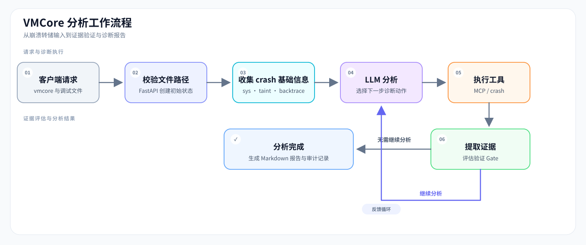

# VMCore Analysis Agent

[English](./README.md) | 简体中文


基于 LangGraph、MCP 和 Linux `crash` 工具的 vmcore 分析服务。本 README 介绍它的工作流程、部署方式和输出。

## 项目能做什么

服务接收 vmcore、匹配的 `vmlinux`、`vmcore-dmesg.txt` 以及可选的模块调试符号，驱动 Agent 循环执行 `crash` 命令并生成 Markdown 分析报告。分析结果用于辅助定位，仍需结合内核版本、符号文件和现场信息由工程师复核。

主要能力：

- 先收集崩溃基础信息（含已加载模块 `mod`），再根据当前分析状态选择后续诊断动作。
- 通过 MCP 调用 `crash` 等工具，对命令执行进行保护和去重；严格约束 `run_script` 语法（执行纯 crash 命令、拦截 shell 控制流并引导循环展开与单步多命令批量取证）。
- 自动检测并提示模块私有结构体类型所需的会话级 `mod -s <module>` 前导符号加载。
- 结合内核源码树提供结构体定义快速定位（`find_struct`）、反汇编代码行映射与补丁验证。
- 使用假设与验证门控跟踪证据；是否关闭门控由执行器根据工具输出判断，而非直接采信模型给出的状态。
- 针对长时分析提供证据按类别截断、关键目标地址锁定与历史消息 Gate 载荷精简，有效控制 Token 消耗与上下文膨胀。
- 内置确定性锁/挂死分析器：解码 mutex/rwsem owner 指针并构建 Wait-For Graph 检测死锁环与根阻塞任务，同时按 CPU 汇总自旋锁争抢、软中断/看门狗与 RCU stall 状态，避免 `bt -a` 原文撑爆上下文。
- 提供同步和 SSE 流式 API；报告正文之外可生成单独的 Gate 审计文件。
- 支持基于 PTY 的常驻 `crash` 会话池引擎与跨进程共享守护进程（`daemon` 模式）：消除每步冷启动、`mod -s` 幂等缓存、超时 3 秒 `SIGINT` 自愈、严格全局 LRU/空闲 TTL 内存管控及多客户端并发访问。

## 工作流程



一次分析大致经过以下步骤：

1. FastAPI 检查请求中的文件路径，并创建 Agent 初始状态。
2. LangGraph 执行初始 `crash` 命令，收集系统、taint 和堆栈信息。
3. LLM 根据当前上下文选择下一步分析或工具调用；`action_guard` 和执行器负责约束、执行工具动作。
4. 证据评估器从工具输出提取事实并更新 Gate。必需 Gate 尚未达到 `closed` 或 `n/a` 时，分析不能标记为已确定。
5. 服务返回分析结果；客户端默认保存 Markdown 报告，并在存在 Gate 数据时保存配套的 `.audit.md`。

### 核心目录

| 路径 | 职责 |
|---|---|
| [`main.py`](./main.py) | FastAPI 服务、分析 API 与生命周期初始化 |
| [`client/`](./client/) | HTTP/SSE 客户端及命令行入口 |
| [`src/react/`](./src/react/) | LangGraph 节点、路由、状态、Prompt、证据评估和报告生成 |
| [`src/llm/`](./src/llm/) | LLM 客户端创建 |
| [`src/mcp_tools/`](./src/mcp_tools/) | MCP 工具注册及 crash、源码补丁、栈保护、锁/挂死等工具 |
| [`tests/`](./tests/) | 单元和集成测试（含 `test_lock_hang_analyzer.py`、`test_lock_hang_client.py`、`test_crash_session_pool.py`） |
| [`doc/`](./doc/) | 架构流程图等项目文档 |
| [`reports/`](./reports/) | 本地生成的报告目录 |

## 部署前准备

服务运行在能够访问 vmcore 文件的 Linux 主机上。准备以下环境和输入：

- Python 3.11 或更高版本，以及 [`uv`](https://docs.astral.sh/uv/)。
- Linux `crash` 工具，以及与 vmcore 内核版本匹配的 `vmlinux` 调试符号。
- 与该 vmcore 对应的 `vmcore-dmesg.txt`。
- 可选：需要分析的第三方内核模块调试符号（`.ko`）。
- 可访问的 OpenAI 兼容模型服务及 API Key。

仓库提供的 mpykdump 安装脚本面向 x86_64，并随附 crash 8.0/9.0 对应扩展。其他 crash 版本需自行准备兼容扩展。

## 快速开始

以下命令以 Linux shell 为例。

### 1. 安装依赖

在仓库根目录执行：

```bash
uv sync
```

如果需要安装仓库提供的 mpykdump 扩展，在仓库根目录执行（脚本会向系统 crash 扩展目录写文件，可能需要 `sudo`）：

```bash
bash tools/install_mpykdump.sh
```

### 2. 配置模型

复制配置模板：

```bash
cp .env.example .env
```

编辑 `.env`，填入模型服务的有效凭据和地址：

```dotenv
REASONING_API_KEY=替换为你的API密钥
REASONING_BASE_URL=https://token-plan.cn-beijing.maas.aliyuncs.com/compatible-mode/v1
REASONING_MODEL=deepseek-v4.1-flash-1017
REASONING_PARAM_PROFILE=deepseek

REASONING_THINKING=enabled
REASONING_EFFORT=max
REASONING_TEMPERATURE=0.1
REASONING_CONTEXT_WINDOW=524288
REASONING_MAX_OUTPUT_TOKENS=48000
REASONING_MIN_THINKING_OUTPUT_TOKENS=40960
REASONING_HISTORY_KEEP=2
LANGSMITH_TRACING=false

# 长度失败熔断阈值与降级配置
REASONING_LENGTH_FAILURE_THRESHOLD=2
REASONING_DEGRADED_MAX_OUTPUT_TOKENS=16000
REASONING_DEGRADED_REASONING_EFFORT=low
REASONING_DEGRADED_THINKING=false

# 可选：源码级验证使用的内核源码树
# KERNEL_SOURCE_ROOT=/data/kernel-src/4.18.0-305.130.1.el8_4.x86_64
KERNEL_SOURCE_ROOT=

# 常驻 Crash 会话池与共享守护进程
CRASH_EXECUTION_MODE=daemon
CRASH_DAEMON_ENDPOINT=unix:///tmp/vmcore_crashd.sock
CRASH_POOL_MAX_SESSIONS=4
CRASH_POOL_SLOTS_PER_VMCORE=1
CRASH_POOL_IDLE_TTL_SEC=900
CRASH_COMMAND_TIMEOUT_SEC=180
CRASH_STARTUP_TIMEOUT_SEC=120
CRASH_MCP_MAX_CONCURRENCY=8
```

| 变量 | 必需 | 说明 |
|---|---:|---|
| `REASONING_API_KEY` | 是 | 模型服务 API Key |
| `REASONING_BASE_URL` | 是 | 模型服务的 OpenAI 兼容 API 地址 |
| `REASONING_MODEL` | 是 | 服务端使用的模型名称 |
| `REASONING_PARAM_PROFILE` | 否 | 网关参数能力档位：`deepseek`（默认，使用 `ChatDeepSeek` 并下发私有 `thinking` 字段）或 `openai`（适用于严格校验 `/v1/chat/completions` 的网关，使用 `ChatOpenAI` 且不发送 `thinking` 字段） |
| `REASONING_THINKING` | 否 | `enabled` 或 `disabled`，默认 `disabled` |
| `REASONING_EFFORT` | 否 | 推理强度（`deepseek` 档位支持 `minimal`、`low`、`medium`、`high`、`max`；`openai` 档位支持 `minimal`、`low`、`medium`、`high`、`xhigh`），默认 `max` |
| `REASONING_TEMPERATURE` | 否 | 采样温度，默认 `0.1` |
| `REASONING_CONTEXT_WINDOW` | 否 | 上下文预算，默认 `524288`；应按模型服务商的实际限制设置 |
| `REASONING_MAX_OUTPUT_TOKENS` | 否 | 最大 completion 预算，默认 `48000` |
| `REASONING_MIN_THINKING_OUTPUT_TOKENS` | 否 | 保持 thinking 模式所需的最低输出预算，默认 `40960` |
| `REASONING_HISTORY_KEEP` | 否 | 压缩时保留的历史 reasoning 数量，默认 `2` |
| `REASONING_LENGTH_FAILURE_THRESHOLD` | 否 | 单次分析中输出长度超限（max_tokens）的熔断阈值，默认 `2`。达到该次数后本次运行的后续调用启用降级配置；设为 `0` 关闭熔断 |
| `REASONING_DEGRADED_MAX_OUTPUT_TOKENS` | 否 | 降级调用的最大 completion 预算，默认 `16000` |
| `REASONING_DEGRADED_REASONING_EFFORT` | 否 | 降级调用的推理强度，默认 `low` |
| `REASONING_DEGRADED_THINKING` | 否 | 降级调用是否启用 thinking，默认 `false` |
| `KERNEL_SOURCE_ROOT` | 否 | 与本次 dump 匹配的内核源码树（也可指向按版本分目录的根目录）；仅在请求未提供 `kernel_source_root` 时生效。启用 `read_source` / `list_writers` / `git_history` / `find_struct`，留空时 agent 会明确说明源码无法核实，而不是凭记忆引用内核代码 |
| `LANGSMITH_TRACING` | 否 | 是否启用 LangSmith 追踪，默认 `false` |
| `CRASH_EXECUTION_MODE` | 否 | Crash 执行后端：`daemon`（默认，跨进程共享守护进程，跨轮次/多 MCP 共享常驻 crash）或 `oneshot`（旧版短生命周期子进程兜底）；旧值 `pool` 已移除，配置时回退为 `daemon` |
| `CRASH_DAEMON_ENDPOINT` | 否 | `daemon` 模式本地通信地址：`unix:///tmp/vmcore_crashd.sock`（默认，自动收紧权限至 `0600`）或 `http://127.0.0.1:8765`（无鉴权，仅限可信单租户主机）；daemon 不可达时快速失败并提示启动命令 |
| `CRASH_POOL_MAX_SESSIONS` | 否 | 全局常驻 `crash` 进程上限（超限时按 `last_used_at` 全局 LRU 淘汰空闲槽），默认 `4`；由 daemon 进程读取 |
| `CRASH_POOL_SLOTS_PER_VMCORE` | 否 | 单个 `(vmcore, vmlinux)` 允许并行持有的常驻进程槽位数，默认 `1` |
| `CRASH_POOL_IDLE_TTL_SEC` | 否 | 空闲会话超时自动回收时间（秒），默认 `900` |
| `CRASH_COMMAND_TIMEOUT_SEC` | 否 | 单条命令超时时间（秒；先 3 秒预算内发 `SIGINT` 挽救，失败再重建），默认 `180` |
| `CRASH_STARTUP_TIMEOUT_SEC` | 否 | 大型 `vmcore` 首次冷启动加载符号超时时间（秒），默认 `120` |
| `CRASH_MCP_MAX_CONCURRENCY` | 否 | `crash` MCP Server 单事件循环并发度（`asyncio.to_thread`），默认 `8`（`daemon` 模式下应配合池容量调小） |
| `CRASH_MCP_TRANSPORT` / `CRASH_MCP_URL` | 否 | 可选常驻 HTTP MCP 服务端/客户端模式（`streamable-http`），未配置时保持默认 `stdio` |

输出长度熔断可配置：`REASONING_LENGTH_FAILURE_THRESHOLD`（默认 `2`，设为 `0` 关闭）、`REASONING_DEGRADED_MAX_OUTPUT_TOKENS`（默认 `16000`）、`REASONING_DEGRADED_REASONING_EFFORT`（默认 `low`）、`REASONING_DEGRADED_THINKING`（默认 `false`）。达到阈值后，同一 run 的后续调用改用降级预算，避免因长度被拒的输出再次按全预算重试。

进程环境变量优先于 `.env`。缺少三个必需模型变量或配置值无效时，服务会在启动阶段报错。不要提交含真实密钥的 `.env` 文件。MCP 工具由代码自动发现，不需要在 `.env` 中填写 MCP 服务路径。

### 3. 启动服务

在仓库根目录使用 `vmcore_agent.bash` 统一启停和控制服务（在默认 `CRASH_EXECUTION_MODE=daemon` 下会自动先拉起并健康检查 `crash-daemon`，再启动监听 `0.0.0.0:8000` 的 agent）：

```bash
# 后台启动（推荐）：按模式联动启动 crash-daemon 与 agent
bash vmcore_agent.bash start

# 或前台运行：自动拉起/复用 crash-daemon 并前台运行 agent
bash vmcore_agent.bash run

# 常用运维控制命令
bash vmcore_agent.bash status   # 查看 agent 与 crash-daemon 状态和日志路径
bash vmcore_agent.bash health   # 查看 crash-daemon 会话池健康状态
bash vmcore_agent.bash logs     # 持续跟踪 agent 与 daemon 日志（Ctrl-C 仅退出查看）
bash vmcore_agent.bash restart  # 重启服务（修改 .env 或更新代码后使用）
bash vmcore_agent.bash stop     # 先停 agent 再停 crash-daemon
```

- 健康检查：<http://localhost:8000/health>
- API 文档：<http://localhost:8000/docs>
- 指标：<http://localhost:8000/metrics>

当前 API 未实现内置身份认证。生产部署时请限制网络访问，或在受控的反向代理/API 网关后提供服务。

### 4. 调用分析

客户端应能访问服务端，且请求中的文件路径必须是**服务端可访问的路径**（客户端不会上传 vmcore 文件）。

```bash
cd client
uv run main.py --health --url http://localhost:8000

uv run main.py --url http://192.168.2.130:8000 --stream \
  --vmcore-path /var/crash/127.0.0.1-2026-11-24-12:01:20/vmcore \
  --vmlinux-path /usr/lib/debug/lib/modules/5.14.0-362.24.1.el9_3.x86_64/vmlinux \
  --vmcore-dmesg-path /var/crash/127.0.0.1-2026-11-24-12:01:20/vmcore-dmesg.txt \
  --debug-symbols /home/calmwu/Program/vmcore-analysis-agent/simulate-crash/rcu_stall/rcu_stall_mod.ko \
  --kernel-source-root /root/kernel-sources/9/5.14.0-362.24.1.el9_3/BUILD/kernel-5.14.0-362.24.1.el9_3/linux-5.14.0-362.24.1.el9.x86_64
```

`--kernel-source-root` 是可选的；第 5 步说明如何准备它所指向的源码目录。

主要参数：

| 参数 | 说明 |
|---|---|
| `--url` | API 服务地址，默认 `http://localhost:8000` |
| `--health` | 只检查服务健康状态 |
| `--stream` | 使用 SSE 流式接口；不指定时使用同步接口 |
| `--vmcore-path` | vmcore 路径 |
| `--vmlinux-path` | 匹配的 `vmlinux` 路径 |
| `--vmcore-dmesg-path` | `vmcore-dmesg.txt` 路径 |
| `--debug-symbols` | 可选的模块调试符号路径，可提供多个 |
| `--kernel-source-root` | 服务端可见的内核源码树路径，通常是 `rpmbuild -bp kernel.spec` 的产物目录（含 `Makefile` 与 `kernel/` 或 `include/linux/`）。优先于 `KERNEL_SOURCE_ROOT`；留空时使用服务端默认配置 |
| `--timeout` | 请求超时秒数，默认 `600` |
| `--output-dir` | 报告输出目录，默认 `../reports`（相对于 `client` 当前目录） |
| `--no-save` | 不保存报告文件 |

### 5. 准备内核源码（可选，用于源码级验证）

有匹配的源码树时，agent 可以读取 `dis -s` 给出的 `file:line` 处真实代码、按类型名快速查找结构体定义及成员声明（`find_struct`，减少交替 grep 与 read 源码的开销）、枚举可能写某个字段的代码路径、并确认这棵树里是否已包含修复。没有源码树时，agent 会明确说明"源码无法核实"，而不是凭记忆引用内核代码。

在**服务端**用 [`tools/get-kernel-source.sh`](tools/get-kernel-source.sh) 准备源码：

```bash
# 1) 使用本地已有的 SRPM
SRC=$(bash tools/get-kernel-source.sh -s /home/user/Downloads/kernel-4.18.0-553.22.1.el8_10.src.rpm)

# 2) 或按内核版本下载 SRPM（需要已启用 source 仓库）
SRC=$(bash tools/get-kernel-source.sh 5.14.0-362.24.1.el9_3)

# 3) 或只定位此前已经准备好的源码树
SRC=$(SKIP_PREPARE=1 bash tools/get-kernel-source.sh 5.14.0-362.24.1.el9_3)
```

脚本会启用匹配的 source 仓库、把 SRPM 安装到独立的 `_topdir`、执行 `rpmbuild -bp`，并且**只在 stdout 输出**准备好的目录（日志全部走 stderr），所以可以直接用 `SRC=$(...)` 取值。支持 RHEL 7/8/9/10。工作区布局：

```text
${SOURCE_ROOT:-/root/kernel-sources}/<RHEL大版本>/<内核版本>/BUILD/kernel-<ver>/linux-<ver>.<arch>/
```

常用参数：`SOURCE_ROOT=/var/lib/kernel-sources` 改变工作区位置，`SKIP_PREPARE=1` 复用已准备的树，`--uninstall` 删除某个工作区。

前置条件与注意事项：

- 脚本需以 root 运行，或使用有权启用仓库、安装 RPM 的账号。
- **服务进程**必须能读该目录。`/root/kernel-sources` 只有 root 可读；若服务以普通账号运行，请把工作区放到共享路径（如 `SOURCE_ROOT=/var/lib/kernel-sources`）并授予读权限。
- `rpmbuild` 用**宿主机的** `%{?dist}` 命名源码树，所以在 el9 机器上准备 el8 的 SRPM 会得到 `linux-...el9...` 目录。只要上游内核版本一致，agent 会接受并在工具输出中写一条 `note` 说明。

然后把打印出的目录传给客户端：

```bash
uv run main.py --url http://localhost:8000 --stream \
  ... \
  --kernel-source-root "$SRC"
```

优先级：请求字段 `kernel_source_root`（`--kernel-source-root`）优先；未提供时使用服务端默认配置 `KERNEL_SOURCE_ROOT`。两者都没有时，源码级验证保持关闭，agent 必须明确说明这一点。

版本匹配：agent 会把源码树版本与 `sys` 报告的内核版本比对。内核版本不同会被拒绝，因此绝不会读错树的代码；只差 `el` 发行标签或架构后缀时会被接受，并附带说明。

## API 与输出

### API

| 方法 | 路径 | 用途 |
|---|---|---|
| `GET` | `/health` | 返回服务、LLM 和工具初始化状态 |
| `POST` | `/analyze` | 同步分析 |
| `POST` | `/analyze/stream` | 通过 Server-Sent Events 返回进度和结果 |

两个分析接口使用相同的 JSON 请求字段：

```json
{
  "vmcore_path": "/data/case/vmcore",
  "vmlinux_path": "/data/case/vmlinux",
  "vmcore_dmesg_path": "/data/case/vmcore-dmesg.txt",
  "debug_symbol_paths": ["/data/case/driver.ko"],
  "kernel_source_root": "/root/kernel-sources/8/4.18.0-553.22.1.el8_10/BUILD/kernel-4.18.0-553.22.1.el8_10/linux-4.18.0-553.22.1.el8_10.x86_64"
}
```

前三个字段必需；`debug_symbol_paths` 可省略或传空数组。`kernel_source_root` 可选，未提供时回落到服务端的 `KERNEL_SOURCE_ROOT`。文件路径由服务端检查。同步响应包含 `success`、`task_id`、`agent_answer`、`token_usage`，以及可选的 `error`、`audit_report`。流式接口以 SSE 事件发送进度，完成事件包含分析结果和审计内容。

### 报告文件

服务当前默认生成英文报告。客户端默认保存分析 Markdown 报告；如果结果中包含 Gate 数据，还会保存同名的 `.audit.md` 文件。`--no-save` 会跳过这两个文件的保存。审计文件记录 Gate 状态、证据和状态转换，适合追溯；常规阅读优先查看主报告中的验证状态摘要。

## 诊断状态与 Gate

`CrashSignatureClass` 表示从崩溃现场初步识别出的签名，用于选择诊断路径；`RootCauseClass` 表示调查后确认的根因类别。两者不是同一层级的分类。

Gate 是分析状态机中的验证检查点。Gate 是否关闭由执行器根据工具输出中的结构化证据评估，模型给出的状态只是建议。当前签名要求的 Gate 尚未全部达到终态时，分析不会被标记为确定。

| 状态 | 含义 |
|---|---|
| `open` | 尚未完成验证 |
| `blocked` | 前置 Gate 未满足，当前检查暂不能完成 |
| `closed` | 已满足相应证据条件 |
| `n/a` | 已确认该检查不适用，需有理由 |

常见检查：

- `register_provenance`：追溯故障寄存器中的值来自哪个指令、对象或字段。
- `object_lifetime`：评估转储中对象/内存槽位的当前状态。比如 `kmem -S` 显示 `[ALLOCATED]` 只能说明转储时槽位已分配，不能据此排除对象曾释放后被复用。
- `local_corruption_exclusion`：结合反汇编和内存观测，检查本地代码是否可能写入异常值。

具体必需 Gate 和完成条件由 [`schema.py`](./src/react/schema.py) 与 [`evidence.py`](./src/react/evidence.py) 定义。

### 长时分析与证据膨胀控制

在长时间复杂 vmcore 分析中，单次 `kmem`、`rd`、`dis` 等命令可能产生数百至上千条结构化事实。为避免上下文超限与历史消息膨胀，系统具备以下机制：

- **门控证据按类别截断与汇总**：门控展示层（`gate.evidence`）按事实前缀分类，每类最多保留 8 条事实，超出部分幂等合并为 `<category>: ... (+N more)` 计数；审计报告中会明确标注为截断视图。
- **关键目标地址锁定与置顶**：通过地址提取自动锁定当前证据目标与动作意图中的关键十六进制地址（含目标对象及生命周期闭合交集地址），确保关键证据不被字典序无关地址挤出。
- **精简历史消息载荷**：写入 `AIMessage` 历史对话的门控状态仅保留 `required_for`、`status` 和 `closure_basis`，剥离冗长的证据文本与完成标准，消除单步 MB 级的消息体积膨胀与重复反序列化开销。
- **完整闭合判定保真**：状态中的 `evidence_facts` 依然保持全量事实，门控闭合判定基于完整事实集执行，不影响判断准确性。

## 锁 / 挂死确定性分析（`lock_hang` 工具包）

`src/mcp_tools/lock_hang/` 是一个独立的 MCP provider，按 [`registry.py`](./src/mcp_tools/registry.py) 的目录约定自动发现，无需改动注册表。它把"遍历所有 CPU 的 `bt -a` / `ps -m` / `runq` 原文"这一步收敛成结构化 JSON，减少上下文占用并消除模型对栈帧的手工解读。

### 两个工具

| 工具 | 适用场景 | 命令参数 |
|---|---|---|
| `analyze_lock_wait_graph` | hung_task、AB-BA 死锁、多个 `UN` 状态任务、`blocked for more than N seconds` | `[--pids <pid1,pid2,...>] [--top <int>] [--max-depth <int>] [--lock-addr <hex>] [--lock-type <mutex\|rwsem>]` |
| `analyze_cpu_lockup_rcu` | soft/hard lockup、自旋锁风暴、RCU stall | `[--cpus <cpu1,cpu2,...>] [--include-idle]` |

两者都接受空字符串，此时：前者自动取 `ps -m` 中阻塞时间最长的前 12 个 `UN` 任务（`--top` 默认 12），后者分析全部非 idle CPU。

### `analyze_lock_wait_graph` 做了什么

1. 一次性 `ps -m` 取任务表（`--pids` 显式指定时跳过筛选）；
2. 用单次 `run_crash_script` 批量合并所有目标任务的 `bt -f`，避免逐 task 启动 crash；
3. 在 Python 侧完成内核锁结构解码——`mutex.owner` 与 `rw_semaphore.owner` 的低 3 位是标志位（`MUTEX_FLAG_WAITERS/HANDOFF/PICKUP`、`RWSEM_READER_OWNED/RD_NONSPINNABLE/WR_NONSPINNABLE`），掩码为 `0x7`，掩掉后才是 `task_struct` 地址；
4. 构建 Wait-For Graph 并 DFS 检出死锁环，另按"被阻塞任务数"排序输出根阻塞任务；
5. 沿 owner 链继续下钻（`--max-depth`，默认 6），直到命中环或收敛到非等待态 owner。

输出包含 `status`（`deadlock_detected` / `wait_graph_built` / `no_uninterruptible_tasks`）、`wait_category_counts`、`deadlock_cycles`、`root_blockers`、`wait_edges`、`non_sleep_lock_or_unresolved_tasks` 与 `recommended_next_commands`。

栈分类按固定优先级扫描（`_CLASSIFY_PRIORITY`）：`mutex` → `rwsem` → `spinlock` → `io_wait` → `irq_softirq`。这里的优先级是必要的——真实栈里 `asm_common_interrupt` 之类的硬件中断入口帧位置在自旋锁帧**之上**，若按帧序先匹配中断帧就会吞掉真正的锁等待。

### `analyze_cpu_lockup_rcu` 做了什么

单次脚本内依次执行 `bt -a`（或 `bt -c <cpus>`）、`runq`、`p rcu_state`，用两个分隔标记切分输出，然后：

- 逐 CPU 归类 `wait_category`，统计 `spinlock_contenders`；
- 判定 idle：栈顶 6 帧命中 `_IDLE_FUNCS`，**且**栈顶 8 帧内没有自旋锁或软中断/看门狗原语——仅凭 `do_idle`/`cpu_idle` 出现不足以判 idle；
- 硬件中断入口帧（`asm_common_interrupt`、`common_interrupt`、`irq_exit`、`nmi_handle`）**不参与** `wait_category` 分类，否则带中断的 idle CPU 会被误判成软中断挂死；
- 软中断/停顿原语（`__do_softirq`、`do_softirq`、`watchdog_timer_fn`、`watchdog_overflow_callback`、`rcu_dump_cpu_stacks`）命中 → `irq_or_softirq_cpus`；非 idle 且命中硬件中断入口 → 单独记录，用于兜底建议；
- `suspected`（输出键 `active_or_suspected_cpus`）只在有实质异常指标时置位：自旋锁等待、看门狗/RCU stall dump、`runq` 就绪队列积压 ≥ 4，或非 idle 且处于自旋锁/软中断上下文。

输出字段：`total_cpus_parsed`、`idle_cpu_count`、`spinlock_contender_count`、`spinlock_contenders`、`irq_or_softirq_cpus`、`active_or_suspected_cpus`、`rcu_state_summary`、`recommended_next_commands`。

> 注意：`irq_or_softirq_cpus` 现在只覆盖**软**中断与停顿检测原语，不包含硬件中断；字段名为兼容既有消费方而保留。

### 建议的使用顺序

锁/挂死快速通道**已启用**，提示词分三层引导模型优先调用分析器，而不是先倾倒 `bt -a` / `foreach UN bt`（实现细节见 [`INTEGRATION.md`](./INTEGRATION.md)）：

- **layer0（每轮注入）**：`3.7a Deterministic Lock / Hang Analyzers` 小节列出两个分析器及语法，规定其优先于 3.5 手工命令和 3.8 的 `hanginfo` 等扩展命令，分析器不可用或结果为空时再回退。
- **playbook（签名确定后）**：`hung_task` 剧本要求先调 `analyze_lock_wait_graph`；`soft_lockup` / `hard_lockup` 共用剧本要求先调 `analyze_cpu_lockup_rcu`；`rcu_stall` 剧本原本就要求先调 `analyze_cpu_lockup_rcu`。
- **SOP 兜底（仅第 1 轮初筛）**：签名尚未分类（`None` / 空 / `unknown`）且完整初始上下文中出现 `blocked for more than`、`soft lockup`、`hard lockup`、`detected stalls on cpus`、`self-detected stall` 等强信号时，注入 `lock_hang_fast_path`；签名落定后自动退场。

顺序建议：

1. 先 `analyze_lock_wait_graph`（等待关系）或 `analyze_cpu_lockup_rcu`（CPU 侧），拿到结构化图/摘要；
2. 再对死锁环成员或根阻塞 CPU 定向执行 `bt -f <task_addr>`、`bt -c <cpu>`、`struct`、`dis -rl`；
3. 命中的锁地址若要单独确认，用 `--lock-addr <hex>` 走单锁 owner 追踪分支（`--lock-type` 省略时按 `mutex` 处理，确认是读写信号量时需显式传 `rwsem`）。

## 常驻 Crash 会话池与共享守护进程

[`src/mcp_tools/crash/`](./src/mcp_tools/crash/) 提供常驻 PTY 会话池（`session_pool.py`）与可选的跨进程守护进程（`daemon.py`），`run_crash_command` / `run_crash_script` 签名保持不变，因此 `crash`、`stack_canary`、`lock_hang`、`scsishow` 全部自动受益。

### 两种执行模式

| 模式 | 运行方式 | 适用场景 |
|---|---|---|
| `daemon`（默认） | 独立运行 `python -m src.mcp_tools.crash.daemon` 托管全局 `CrashSessionPool`；所有 MCP Server 与并发 Worker 通过 Unix Domain Socket（`0600`）或 HTTP 共享 | 生产多客户端并发、多 MCP 协同分析（同一 `vmcore` 全程仅冷启动 1 次，内存 1×） |
| `oneshot` | 回退为旧版每条命令独立 `subprocess.Popen` | 紧急回滚或非 POSIX（Windows）开发/CI 机 |

> 旧值 `pool` 已移除：stdio 架构下 MCP 子进程每轮 `async with session()` 起停，进程内会话池无法跨 ReAct 轮次存活（"整个分析只冷启动 1 次"的目标只有 `daemon` 能达成）。显式配置 `pool` 会回退为 `daemon`；`CrashSessionPool` 类保留，仅作为 daemon 进程的核心引擎。daemon 不可达时工具调用快速失败并提示启动命令，不再提供进程内池回退。

### 生产启动共享守护进程（daemon 模式必读）

`daemon` 是默认执行模式，**必须先完成本节步骤，再启动主服务**（`.env` 中保持 `CRASH_EXECUTION_MODE=daemon`，客户端 `CRASH_MCP_URL` 留空走 stdio）。守护进程未启动时工具调用会直接报错并提示启动命令（快速失败，不再静默回退进程内池，避免会话池分裂导致内存翻倍）。

```bash
# 1) 后台启动跨进程共享守护服务（或一键启动 daemon + agent；Unix Socket 自动收紧为 0600 权限；
#    重复执行不会重复启动；需要 TCP 时先 export CRASH_DAEMON_ENDPOINT=http://127.0.0.1:8765）
bash vmcore_agent.bash start daemon   # 或直接: bash vmcore_agent.bash start

# 查看运行状态、会话池健康信息和日志
bash vmcore_agent.bash status        # PID / endpoint / 运行状态
bash vmcore_agent.bash health        # /health：活跃会话、VmRSS、命中/淘汰统计
bash vmcore_agent.bash logs daemon   # 持续跟踪日志（Ctrl-C 只退出查看，不停服务）

# 验证修复生效：启动日志中应出现
#   [crash spawner] resident spawner thread started (tid=...)
# 运行分析后 health 中 restart_count 应保持 0（crash 不再退出）
bash vmcore_agent.bash logs daemon | grep "crash spawner"
```

| 脚本子命令 | 说明 |
|---|---|
| `start [all\|daemon\|agent]` | 后台启动（`setsid` + PID 文件防重复启动；启动失败自动打印最近 50 行日志） |
| `stop [all\|daemon\|agent]` | 向进程组发 `SIGTERM` 优雅停止（默认等 30s，超时才 `SIGKILL`），先停 agent 再停 daemon |
| `restart [all\|daemon\|agent]` | `stop` + `start`，会关闭并重新创建 crash 会话（升级代码后用这个） |
| `run [agent\|daemon]` | 前台运行（默认 `agent` 自动拉起/复用 daemon；`daemon` 适合 systemd 托管或直接调试） |
| `status` / `health` / `logs [agent\|daemon\|all]` | 进程状态 / 会话池健康 / 日志跟踪 |

脚本环境变量（均可选）：`CRASH_DAEMON_ENDPOINT`（默认 `unix:///tmp/vmcore_crashd.sock`，支持 `http://127.0.0.1:8765`）、`VMCORE_RUN_DIR`（PID 目录，默认 `logs/`）、`CRASH_DAEMON_LOG_FILE`（默认 `logs/crash-daemon.log`）、`VMCORE_STOP_TIMEOUT`（默认 30s）。

```bash
# 不使用脚本时的前台启动方式
uv run python -m src.mcp_tools.crash.daemon --endpoint unix:///tmp/vmcore_crashd.sock
```

```bash
# 代码更新后的标准流程（重启 daemon 使新代码生效）
bash vmcore_agent.bash restart daemon
bash vmcore_agent.bash health   # 确认会话池正常

# 3) 可选：将 crash MCP Server 独立为常驻 streamable-http 服务
CRASH_MCP_TRANSPORT=streamable-http CRASH_MCP_HOST=127.0.0.1 CRASH_MCP_PORT=8766 \
  uv run python -m src.mcp_tools.crash.server
```

守护服务暴露 `GET /health`（活跃会话、各 `crash` 进程 `VmRSS`、命中/淘汰统计）、`POST /execute` 以及 `POST /evict`（兼容 `DELETE /sessions`）用于主动释放指定 `vmcore` 的空闲会话。

### 核心工程保障

- **哨兵帧协议与关闭回显**：关闭 PTY 从端 `ECHO`，握手阶段一次性消费启动 Banner，并用 `!echo __CRASH_DONE_<uuid>__` + `crash> ` 双校验切分输出，彻底消除旧版关键词误删与伪提示符错位。
- **`mod -s` 幂等缓存**：归一化裸命令 / `auto` / 具体路径，按模块逐行校验加载错误（失败绝不写脏缓存），已加载模块自动跳过。
- **两级超时自愈**：超时后先在统一 3 秒预算内向进程组发送 `SIGINT` 挽救会话并保留已加载符号；恢复失败或进程意外退出时才杀进程组自动重建并报告 `exit_code`。
- **多并发与防 OOM**：不同 `vmcore` 真并行；`server.py` 通过 `asyncio.to_thread` 与按事件循环隔离的 `WeakKeyDictionary` 信号量解除事件循环阻塞；按 `last_used_at` 严格全局 LRU 淘汰与后台空闲 TTL 回收控制宿主机内存。

## 崩溃复现场景（`simulate-crash/`）

`simulate-crash/` 下是几个用来**人为制造崩溃现场**的内核模块，用于生成可复现的 vmcore，测试和演示 agent 的各类分析剧本。只能在测试机或虚拟机上使用。每个目录都有自己的 README，说明构建、触发和分析步骤。

| 目录 | 模块 | 模拟的场景 | 主要参数 | agent 应判定的 `signature_class` |
|---|---|---|---|---|
| [`soft_lockup/`](./simulate-crash/soft_lockup/) | `soft_lockup_module.ko` | 用 `mode` 选择 4 种 CPU 锁死：`busy`（关抢占忙等）、`spinlock`（持锁不放 + 另一 CPU 争抢）、`softirq`（在定时器软中断里忙等）、`irqoff`（关中断忙等，需 `allow_irqoff=1`） | `mode`、`cpu_number`、`contender_cpu`、`enable_soft_lockup`（运行时可切换） | `soft_lockup`；`irqoff` 为 `hard_lockup` |
| [`rcu_stall/`](./simulate-crash/rcu_stall/) | `rcu_stall_mod.ko` | 读者线程在 `rcu_read_lock()` 内长时间睡眠，配合宽限期等待者，制造 RCU stall | `stall_duration_ms` | `rcu_stall` |
| [`dma_memory_corruption/`](./simulate-crash/dma_memory_corruption/) | `dma_memory_corruption_mod.ko` | 模拟 DMA 越界写，覆盖相邻页里对象的函数指针；可选再破坏该页的 `struct page`，在释放路径上崩溃 | `enable_dma_corruption`、`corrupt_page_struct`、`corruption_len`、`start_delay_ms` | 函数指针模式为指针破坏类；`struct page` 模式通常在页释放路径上崩溃 |

几点约定：

- **编译选项**：三个模块的 Makefile 都使用 `ccflags-y := -g`，按内核默认的 `-O2` 编译，**不再使用 `-O0` / `-Og`**（内核只支持 `-O2` / `-Os`）。需要在栈里单独出现的函数在源码中标了 `noinline`。`.ko` 不要 strip，分析时用 `--debug-symbols` 传入。
- **版本一致**：编译后用 `make vermagic` 确认 `.ko` 对应的内核版本和测试机一致（示例环境为 `5.14.0-362.24.1.el9_3.x86_64`）。
- **基线变化**：改为 `-O2` 后，指令偏移、寄存器分配都和旧版本不同。`reports/` 里用旧 `.ko` 生成的报告不能直接与新版本对比，需要重新生成 vmcore。
- **触发 panic**：soft lockup 需要 `kernel.softlockup_panic=1`，hard lockup 需要 `kernel.nmi_watchdog=1` 和 `kernel.hardlockup_panic=1`，RCU stall 需要 `kernel.panic_on_rcu_stall=1`，并且 kdump 正常工作。详见各目录 README。

## 项目结构

```text
vmcore-analysis-agent/            # 仓库根目录
├── README.md
├── README.zh-CN.md
├── main.py                   # FastAPI 入口
├── vmcore_agent.bash         # 统一启停与运维控制脚本（联动 agent 与 crash-daemon）
├── client/                   # CLI 与 HTTP/SSE 客户端
├── src/
│   ├── llm/                  # 模型初始化
│   ├── react/                # Agent 图、Prompt、状态、证据和报告
│   ├── mcp_tools/            # MCP 工具
│   └── utils/                # 设置与日志
├── tests/                    # 测试
├── tools/                    # 运维和调试辅助脚本
├── doc/                      # 流程图等文档
├── simulate-crash/           # 崩溃复现场景（见“崩溃复现场景”一节）
│   ├── soft_lockup/          # soft/hard lockup：busy / spinlock / softirq / irqoff
│   ├── rcu_stall/            # RCU stall
│   └── dma_memory_corruption/  # DMA 越界写 / struct page 破坏
├── reports/                  # 报告输出目录
├── ARCHITECTURE.md           # 架构与核心逻辑（维护者读码地图）
├── INTEGRATION.md            # lock_hang 工具集成指南
├── pyproject.toml
├── uv.lock
└── .env.example
```

## 常见问题

- **服务启动提示缺少配置**：检查 `.env` 或进程环境中是否设置了 `REASONING_API_KEY`、`REASONING_BASE_URL`、`REASONING_MODEL`。
- **模型网关报错 `400 unsupported_parameter: 'thinking'`**：部分严格校验 `/v1/chat/completions` 的网关不接受 DeepSeek 私有的 `thinking` 字段，请在 `.env` 中设置 `REASONING_PARAM_PROFILE=openai`，并将 `REASONING_EFFORT` 设为网关支持的值。
- **执行 crash 脚本提示 `shell control flow is not executable by crash` 或语法被拦截**：`run_script` 的每个参数仅执行单条 crash 原生命令，不支持 `for`/`while`/`if` 循环、分号、`&&`、重定向（如 `2>/dev/null`）或 shell 变量。应将循环展开为逐行独立的 crash 命令（支持在同一次 `run_script` 中批量传入多行以减少交互步数）。
- **执行 crash 脚本提示 `gdb request failed` 或结构体无法识别**：若引用的结构体属于第三方或内核模块私有类型，由于每次 `run_script` 都是独立的 crash 进程会话，脚本中需在读取该类型前显式执行 `mod -s <module>` 加载模块符号。
- **Windows / 非 POSIX 环境使用 `daemon`（`unix://`）报错**：常驻 PTY 会话依赖 POSIX `pty`/`termios`，`unix://` 依赖 `AF_UNIX`。Windows 开发/CI 请设置 `CRASH_EXECUTION_MODE=oneshot`（或用 `http://` 测试 TCP 守护模式）。
- **`daemon` 模式下高并发触发获取槽位超时**：所有 MCP 进程共享守护进程侧的 `CRASH_POOL_MAX_SESSIONS`；请配合池容量调小 `CRASH_MCP_MAX_CONCURRENCY`，或按宿主机可用内存适当调大 `CRASH_POOL_MAX_SESSIONS`。
- **文件不存在**：传给 API 的路径在服务端解析，不是运行 CLI 的客户端本地路径。
- **crash 命令或扩展不可用**：确认服务主机已安装 `crash`，符号文件与 vmcore 对应；仓库脚本只适用于 x86_64 的 crash 8.0/9.0。
- **模块缺少源码/符号信息**：为对应内核和模块准备匹配的调试符号；可参考下方附录。
- **锁/挂死分析返回 `no_uninterruptible_tasks` 或空图**：确认 vmcore 与该 `vmlinux` 严格匹配，且目标任务确实处于 `UN` 状态；`ps -m` 不可用时改用 `--pids` 显式指定任务。解析不到 owner 的任务会出现在 `non_sleep_lock_or_unresolved_tasks` 里，通常需要回归 `bt -f` + `dis` 手工确认栈槽位。
- **API 长时间无响应**：尝试 `--stream` 查看进度，并根据分析耗时调整客户端 `--timeout`。若多次遇到输出长度超限，可确认已启用 `REASONING_LENGTH_FAILURE_THRESHOLD` 熔断降级。

## 附录：第三方驱动调试符号编译指南（以 mlx5_core 为例）

在分析涉及第三方驱动（如 Mellanox 网卡驱动）的 vmcore 时，如果默认驱动缺少调试符号，需要手动安装源码并重新编译。以下是标准操作流程：

### 1. 环境准备

安装驱动源码包和对应的内核开发包：

```bash
# 安装 Mellanox 驱动源码
rpm -ivh mlnx-ofa_kernel-source-5.8-OFED.5.8.3.0.7.1.rhel8u4.x86_64.rpm

# 安装对应版本的内核开发包（需与 vmcore 的内核版本一致）
rpm -ivh --oldpackage kernel-devel-4.18.0-305.130.1.el8.x86_64.rpm
```

### 2. 编译带调试信息的模块

进入源码目录并配置编译选项：

```bash
cd /usr/src/ofa_kernel-5.8/source

# 配置编译选项：开启 debug info，指定内核源码路径
./configure --with-debug-info --with-mlx5-mod \
                 --kernel-sources /usr/src/kernels/4.18.0-305.130.1.el8_4.x86_64 \
                 --cache-file=my_config.cache

# 执行编译
make -j$(nproc)
```

### 3. 验证调试符号

编译完成后，通过以下方式验证模块是否包含调试信息：

```bash
# 1. 检查 debug section 是否存在
readelf -S drivers/net/ethernet/mellanox/mlx5/core/mlx5_core.ko | grep debug

# 2. 尝试反汇编导出源码（验证源码关联）
objdump -S -d drivers/net/ethernet/mellanox/mlx5/core/mlx5_core.ko > mlx5_debug.asm

# 3. 使用工具脚本验证符号解析
# 从仓库根目录执行
cd /path/to/vmcore-analysis-agent
bash tools/show_first_global_func.sh /usr/src/ofa_kernel-5.8/source/drivers/net/ethernet/mellanox/mlx5/core/mlx5_core.ko
```

## 贡献与许可

欢迎提交 Issue 和 Pull Request。本项目完全开源，采用 MIT License；发布时请确保发行包包含对应的许可证文本。

## 联系方式

- 邮箱：[wubo0067@hotmail.com](mailto:wubo0067@hotmail.com)
- GitHub：[wubo0067](https://github.com/wubo0067)
